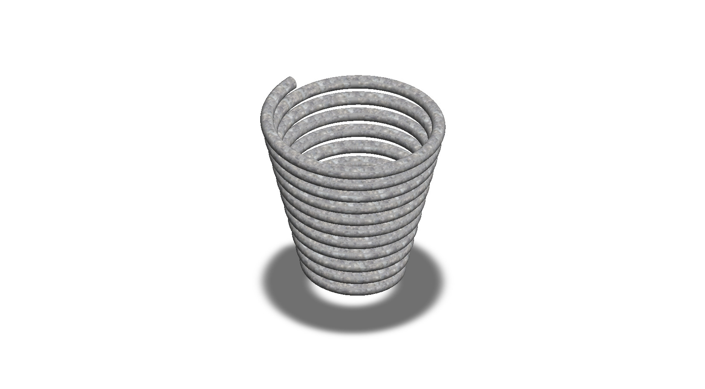
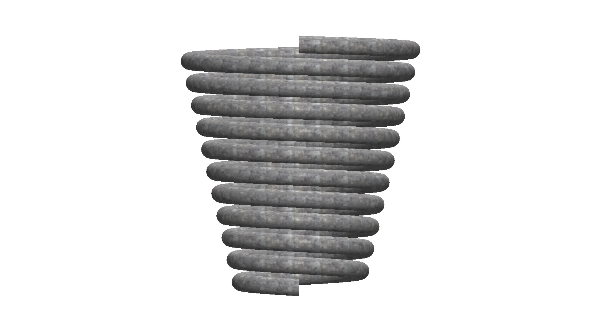
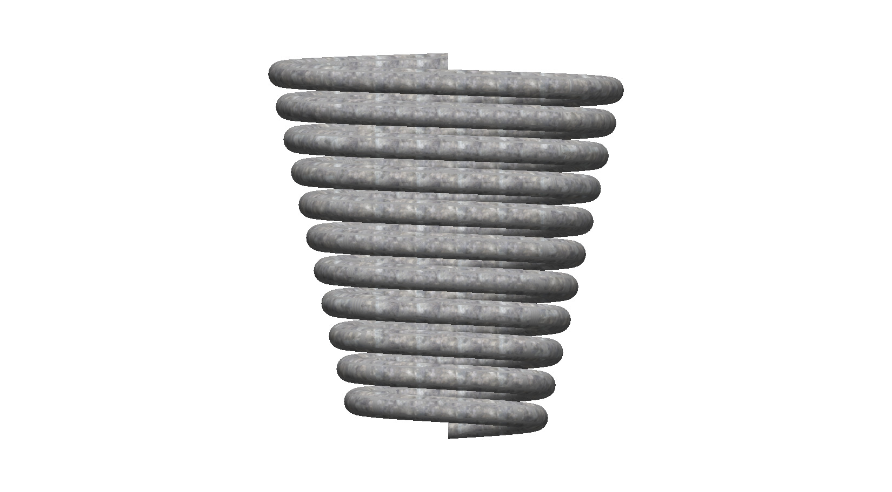
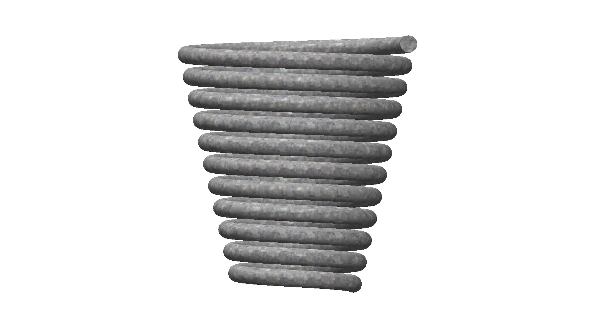
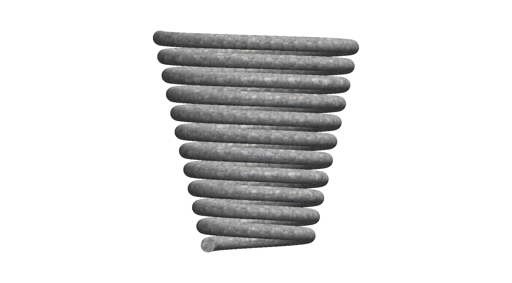
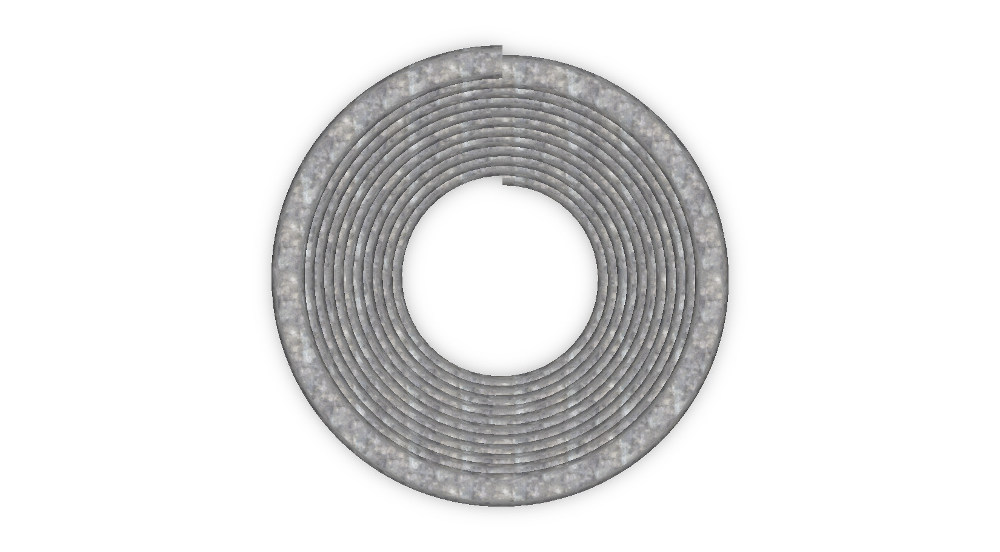
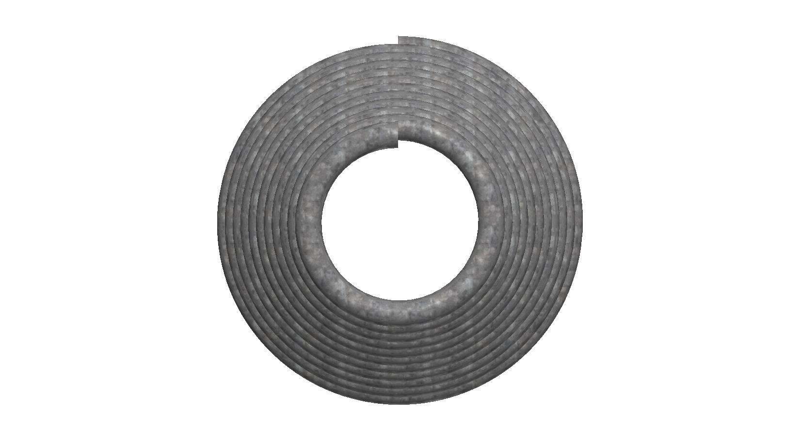
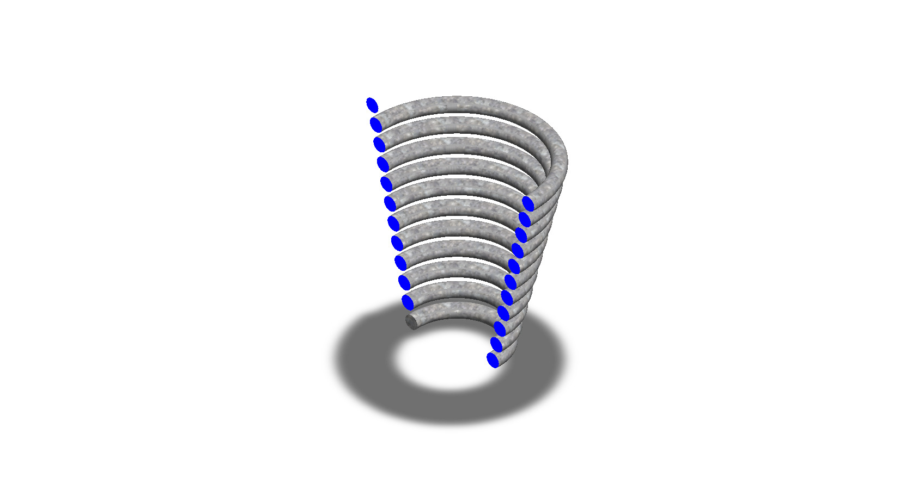

# A Tapered Conical Coil Spring Modeled as a Continuous Helical Sweep

## Summary

A spring stores energy when it is deformed and releases it when the load is removed, which is why it appears in everything from pens to vehicle suspensions. Most springs have a constant coil diameter, but a conical spring tapers from a wide base to a narrower top. This project explores how such a tapered coil can be modeled computationally.

The model is a single wire that winds around a vertical axis in about ten turns. The coil diameter becomes smaller toward the top, which gives the spring its cone-like outline, and the free end of the wire is left exposed at the top turn. The coils are evenly spaced, so the shape looks smooth and continuous from the base to the top. The main challenge was to control the taper and the spacing together, because a small change in one of them changes the height and the overall shape of the spring.

The spring was developed as a computational model in SolidWorks. The views below show the coils from every side, along with a section view that shows the circular cross-section of the wire. This prototype is a base concept design that can be developed further into a spring with defined material properties and load behavior.

---

## Computational Design

|   View    |                        Image                        |
| :-------: | :-------------------------------------------------: |
| Isometric |  |
|   Left    |            |
|   Right   |          |
|   Back    |            |
|   Front   |          |
|    Top    |              |
|  Bottom   |        |
|  Section  |      |

---

## Software Used

| Purpose |               Name                |
| :-----: | :-------------------------------: |
| Design  | SolidWorks 2024 (Student Version) |

---

## Tools Used

| No  | Name |
| :-: | :--: |
| 01  |      |
| 02  |      |
| 03  |      |
| 04  |      |
| 05  |      |
| 06  |      |
| 07  |      |
| 08  |      |
| 09  |      |
| 10  |      |

---

## Image of the Tool Used

---

## Applications [^1][^2]

- Automotive Suspension Systems
- Engine Valve Mechanisms
- Safety and Industrial Valves
- Shock Absorbers and Actuators
- Large Machinery
- Household Items such as Ballpoint Pens and Mattresses

---

## Design Limitations

The design of the spring was developed as a geometric prototype. That’s why the real-life design considerations, including material selection, spring rate, load and fatigue analysis, buckling and surge checks, end-type standards, proper design specification, and feasibility, have not been included.

---

## Future Improvements

The spring was created as a geometric helix, so no loads or materials are defined. Wire diameter, coil diameter, pitch, number of active coils, and end type should next be linked to design equations to calculate spring rate and solid height. Material selection (such as music wire or spring steel), static and fatigue analysis, and checks for buckling and surge would then validate the design. Experimental load-deflection testing would confirm the simulated spring rate.

---

## Acknowledgements

Special thanks to the [EasyCAD Solutions](https://www.youtube.com/@EasyCADSolutions) YouTube channel for the SolidWorks tutorials that helped in creating this design.

---

## References

[^1]: [Compression spring applications](https://www.lesjofors.com/sv/teknik/insights/compression-spring-application/)

[^2]: [US6543757B2 - Helical compression spring for a vehicle suspension](https://patents.google.com/patent/US6543757)
